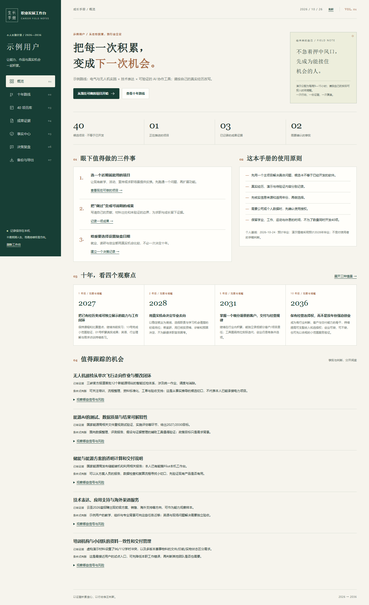
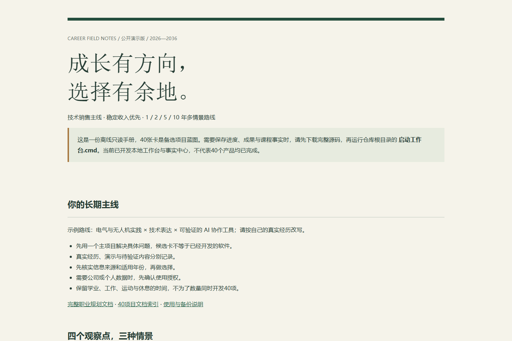

# 职业发展工作台

**把职业想法、项目实践和事实核验放在同一个本地工具里。**

一个使用 Python 标准库与原生网页技术制作的中文个人工作台：保存成果证据、记录选择理由、筛选项目蓝图，并在宣传材料写出之前核对“这句话有没有来源、是否过期、是否存在冲突”。无需注册、API 密钥或付费服务。

**[打开静态只读手册](https://yangwei251003.github.io/career-workbench/)** · 完整七视图与个人数据保存使用本地 Python 版。



> **当前状态：V1 本地功能已实现，持续维护。** 公开版使用虚构演示用户和合成记录，不包含原作者的私人运行数据。内置 40 张卡是候选项目蓝图，不能视为 40 个已完成的软件。

## 可以做什么

| 视图 | 用途 |
|---|---|
| 概览 | 查看记录情况、待核实事项与下一步 |
| 职业路线 | 阅读 1 / 2 / 5 / 10 年的最好、基准与压力情景 |
| 项目库 | 按类别与启动条件筛选 40 张蓝图，收藏、记录状态、下载卡片或复制提示词 |
| 成果证据 | 把本人贡献、来源、日期与证据边界一起保存 |
| 事实中心 | 比较同一事项的不同说法；核查状态、来源、确认人与有效期；只导出符合条件的事实底稿 |
| 决策复盘 | 保存假设、证据、下一步和退出条件，记录真实试用反馈 |
| 备份与导出 | JSON 预览恢复、Markdown / CSV 导出，修改前自动保存历史备份 |

技术重点包括：修订号防止多窗口静默覆盖、原子写入、恢复前备份、字段校验、事实冲突判断、CSV 公式保护、用户文本转义，以及不会用初始数据静默覆盖损坏的个人记录。

## 技术栈与前置条件

- **运行环境：Python 3.12 或更高版本**，本次在 Windows / Python 3.12 验证。
- **服务端：** Python 标准库 HTTP 服务、JSON 文件持久化，无运行时第三方依赖。
- **界面：** HTML、CSS、原生 JavaScript，无 Node 构建步骤。
- **浏览器：** 现代 Chrome、Edge、Firefox 等；本次浏览器自动化使用 Chromium。
- Playwright 只用于开发验收，日常使用不需要安装。

## 五分钟上手

1. 下载仓库 ZIP 并解压，或使用 Git 克隆完整仓库。
2. 安装 Python，打开终端确认版本：

   ```powershell
   python --version
   ```

3. 进入解压后的项目根目录，启动：

   ```powershell
   python server.py --port 8026
   ```

4. 在浏览器打开 **http://127.0.0.1:8026**。
5. 在启动终端按 `Ctrl+C` 停止。重新启动后，原有记录会从本机读取。

Windows 也可双击 **启动工作台.cmd**：自动选端口并打开浏览器；**停止工作台.cmd** 会核对当前目录身份后停止该实例。macOS / Linux 可在安装 Python 后尝试上述终端方案，本次未在第二台设备或这两个系统实测。

首次启动会创建 `data`。若端口被其他程序占用，可以改用 `--port 8027`。请勿只复制 `app` 文件夹：完整应用还需要服务端与 `catalog`。

## 在线与离线阅读版

**GitHub Pages 适合公开只读手册，不运行 Python 后端。** 仓库提供的 Pages 工作流发布一份可搜索、筛选、展开卡片的静态阅读版，供直接了解路线示例与项目蓝图；它不保存个人记录。完整七视图工作台请按上面的步骤在本机运行。

- 直接双击仓库根目录 `阅读总览.html`，可离线阅读，不需要启动服务。
- 本地重建阅读版：

  ```powershell
  python catalog/build_catalog_docs.py
  python build_delivery.py
  python build_pages.py
  ```

- GitHub 发布时，在仓库 **Settings → Pages** 中选择 **GitHub Actions** 作为来源，运行 `Publish read-only handbook` 工作流。实际线上状态以该仓库 Actions 与 Pages 结果为准。



## 如何试用事实核验

初始合成记录对“演示培训课程的总学时”提供 **96** 和 **112** 两种说法，均标为待核实。这是刻意设置的冲突，并非真实机构课程。

先查看冲突原因，再创建自己的演示记录。确认事实时填写来源、来源日期、有效截止、确认人与确认日期；已过期、待核实或有冲突的条目不会进入可用底稿。保存确认只是使用者记录核查结果，不能替代机构审批或原始证据。

## 文件结构

```text
app/                       中文界面、样式与浏览器交互
catalog/                   固定蓝图、演示种子与文档生成器
docs/项目卡/                40 张候选蓝图
docs/examples/             合成数据说明
server.py                  HTTP 服务、数据校验与持久化
launch.py / stop.py         本地启动与停止
build_delivery.py          离线手册与 CSV 生成
build_pages.py             Pages 静态阅读版生成
tests/                     标准库业务、存储与 HTTP 回归
qa/                        开发用浏览器验收脚本和结果
assets/                    使用合成数据的真实界面截图
data/、backups/             运行时创建，不提交至 GitHub
```

## 数据保存与恢复

- 记录保存在本机 `data/state.json`，不依赖浏览器缓存。每次修改前，旧版本保存在 `backups`。
- 在“备份与导出”下载 JSON；恢复前先预览，确认后替换当前记录，并保留恢复前备份。
- Markdown / CSV 用于阅读和分析；完整迁移使用 JSON。当前不支持把 Markdown / CSV 自动导回。
- 更换电脑时复制完整项目，并单独迁移自己的 `data` / `backups`。**不要把个人记录提交到公共仓库。**
- 数据文件损坏时程序会保留文件并报错，不会用演示种子静默重置。恢复前先另存原件。
- 同一硬盘上的自动备份不能应对硬盘损坏，请自行保留独立副本。

## 开发与验证

无需安装依赖即可运行主要回归：

```powershell
python -m unittest discover -s tests -v
```

浏览器验收为可选开发步骤：

```powershell
python -m pip install playwright
python -m playwright install chromium
python qa/browser_checks.py
python qa/handbook_checks.py
```

测试使用临时目录，不写入正式 `data`。修改初始内容后运行生成器，仅重建 `catalog` 与文档，不迁移已有个人数据。验证范围见 [公开版核查记录](docs/公开版核查记录.md)。

## 更新记录与后续计划

- **2026-10-24 · V1：** 本地七视图、40 张蓝图、事实核验、备份与导出。
- **2026-10-26 · 开源整理：** 更换合成种子，清理原本机路径与雇主材料引用；生成器同步脱敏；补充 MIT 许可、截图、公开文档和 Pages 静态手册工作流。
- **后续：** 根据实际试用修正文案和易用性，逐步补充跨系统验证；新增功能以真实需求与验收为准。

当前没有账号权限管理、在线多人协作、自动政策更新、自动投递、语音识别或收入/录取概率预测。业务采用与真实效果尚未验证。外部参考链接沿用研究日期，使用前请核实当时有效的一手来源。

## 开源许可与来源

原创程序、文档与合成演示内容采用 [MIT License](LICENSE)。本项目由杨炜晨负责需求规划、研究与 AI 协作开发；不据此声称独立手写全部代码。

Python、浏览器与可选 Playwright 遵循其各自许可；外部资料仅作为来源链接，不包含原始证书、招聘附件、课程原件或第三方图片。源码中的合成示例不构成就业、升学或经营建议。
